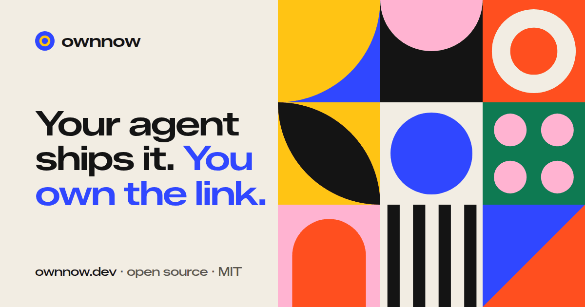
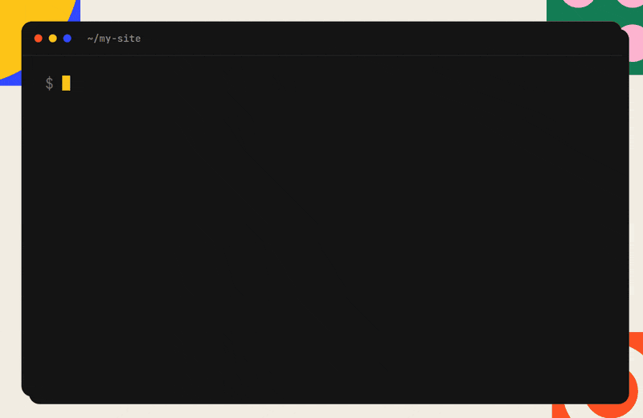

<p align="center">
  <a href="https://ownnow.dev"></a>
</p>

# ownnow

**Your agent ships it. You own the link.**

Tell your agent "publish this" and get a live URL in seconds. Your
server, your domain, your storage. ownnow is an open-source here.now
alternative: one Go binary, MIT licensed, nobody in the middle.

```bash
ownnow publish ./my-site
# -> https://now.yourdomain.com/bright-canvas-a7k2/
```



**Website:** [ownnow.dev](https://ownnow.dev) ·
**Install:** grab the binary for macOS, Linux, or Windows from the
[latest release](https://github.com/harssha6/ownnow/releases), or build
from source below.

 Static sites,
images, PDFs, Wasm apps, any file type.

## How it works

Three calls, and a site is never half-live:

1. **Create.** The server reserves a slug like `bright-canvas-a7k2` and
   returns signed upload URLs.
2. **Upload.** Files go straight to your storage over presigned URLs.
   They never pass through the server.
3. **Finalize.** One atomic switch publishes the version. Every version
   is kept, so rollback is a pointer flip.

## Bring your own infra

| Path | You need | Serving cost |
|---|---|---|
| **Docker anywhere** (default) | Any VPS and a domain | Your host's bandwidth |
| **Cloudflare** | A domain on Cloudflare and an R2 bucket | **$0 egress** on R2, Workers free tier |
| **Single binary** | Nothing | Local development only |

### 1. Docker anywhere

```bash
git clone https://github.com/harssha6/ownnow && cd ownnow
cp .env.example .env        # set OWNNOW_DOMAIN, OWNNOW_API_KEY, OWNNOW_SECRET
docker compose up -d
```

Point your domain's DNS `A` record at the host. Caddy provisions TLS
automatically. Sites live at `https://<your-domain>/{slug}/`, or at
`https://{slug}.<your-domain>/` if you add wildcard DNS and set
`OWNNOW_BASE_DOMAIN`. Storage is a local volume by default; set
`OWNNOW_STORAGE=s3` to use R2, S3, or MinIO instead.

### 2. Cloudflare (zero-egress serving)

The Go binary becomes a publish-only control plane that can run
anywhere, even a laptop. A TypeScript Worker serves traffic from R2 at
the edge:

```bash
cd worker && bun install
bunx wrangler r2 bucket create ownnow
cp wrangler.example.toml wrangler.toml   # your domain + bucket
bun run deploy                            # wildcard {slug}.your-domain
```

Run the Go server with `OWNNOW_STORAGE=s3` and your R2 keys (see
`.env.example`). Uploads are presigned, so file bytes never pass
through the server.

### 3. Single binary

```bash
go build -o ownnow ./cmd/ownnow
OWNNOW_API_KEY=$(openssl rand -hex 32) ./ownnow serve   # :8080, local disk
```

## Publishing

```bash
ownnow publish ./site [--slug name] [--password pw] [--ttl-hours 24] [--spa]
ownnow list
ownnow rollback <slug> <version-id>
ownnow delete <slug>
```

**Included:** version history and rollback, password-protected sites,
TTL and expiry, anonymous 24-hour sites with claim tokens, SPA
fallback, custom `404.html`, directory listings, correct
`application/wasm` plus COOP and COEP headers for Wasm and games, and
Range requests.

**For AI agents:** an agent skill lives in [`skill/`](skill/). Point
Claude, Cursor, or another agent at it, set `OWNNOW_SERVER` and
`OWNNOW_API_KEY`, and "publish this" works against your instance.

## Auth model

Deliberately boring. **One bearer key** (`OWNNOW_API_KEY`) guards
publishing. You generate it. There are no accounts, no hosted control
plane, and no telemetry. Nothing phones home. Without a key, the
server runs in anonymous mode: sites expire after 24 hours and a claim
token guards updates. That is good for demos, not for production.

## FAQ

**How is it different from here.now?** here.now is a hosted service.
ownnow is software you run yourself, with no accounts, no hosted
control plane, and no telemetry. Some here.now features, like email
allowlists, analytics, and teams, are not built yet.

**What does it cost to run?** The software is free. You pay for your
own server and bandwidth. On Cloudflare, R2 has no egress fees and the
serving Worker fits the free tier.

**What can I publish?** Static files: HTML sites, images, PDFs, and any
other file type. Single-page apps, custom 404 pages, and Wasm games
work. ownnow does not run server-side code.

**Do I need my own domain?** For public sites, yes. Point an A record
at your server and Caddy handles TLS. For local work, the single
binary runs on localhost.

More answers on [ownnow.dev](https://ownnow.dev/#faq).

## Architecture

- **Server and CLI: Go**, stdlib only, `CGO_ENABLED=0`, one static
  binary. Even the S3 SigV4 signing, including presigned URLs, is
  hand-rolled in `internal/store`. No AWS SDK.
- **Storage:** local disk or any S3-compatible store, with R2
  first-class. Site metadata is JSON next to the files. Versions are
  immutable prefixes, so finalize and rollback are pointer flips.
- **Edge (optional):** a TypeScript Worker (`worker/`, Bun and
  Wrangler) reads the same R2 layout. Rust was evaluated and skipped:
  the Worker is about 150 lines of fetch logic where it buys nothing.

## Roadmap

**Done:** core publish flow, versions and rollback, password sites,
TTL, SPA fallback, custom 404, Wasm and cross-origin isolation.
**Not yet:** email allowlists, site data and forms, analytics,
custom-domain mounts, folders and search, teams. PRs welcome.

## Development

```bash
go test ./...
cd worker && bun install && bunx tsc -p tsconfig.json
```

The website lives in [`examples/demo-site`](examples/demo-site) and
deploys to [ownnow.dev](https://ownnow.dev) on Vercel from `main`.

## License

MIT. See [LICENSE](LICENSE).

---

Made by [Harssha Vardan](https://harssha.design) ·
[X](https://x.com/Harsshavardan3) ·
[GitHub](https://github.com/harssha6) ·
[LinkedIn](https://www.linkedin.com/in/harssha-vardan-a031371a4/)
